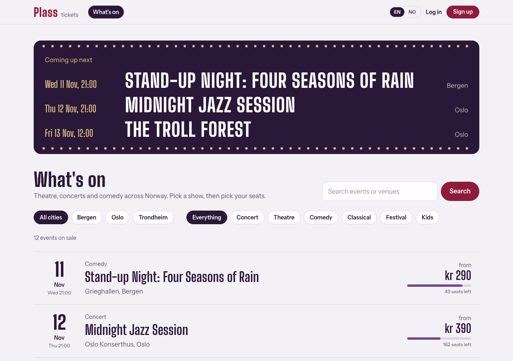
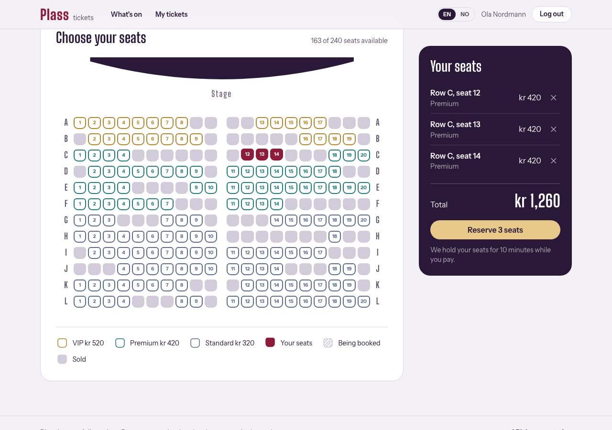
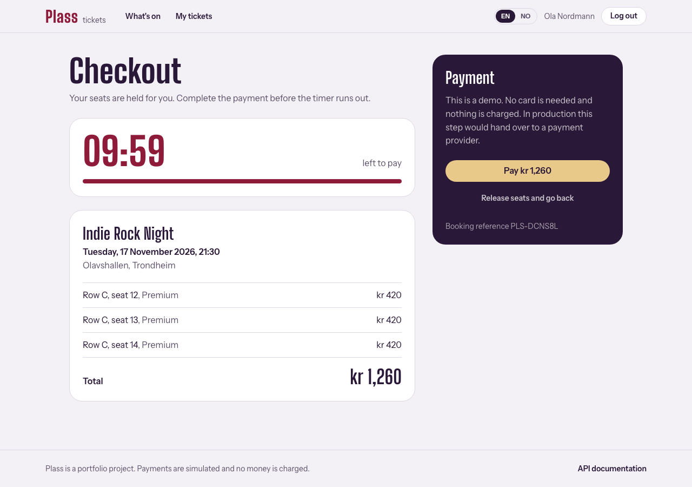
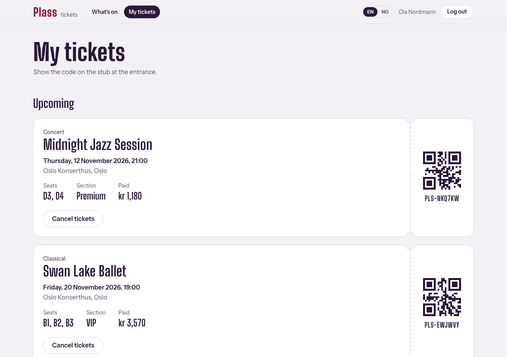
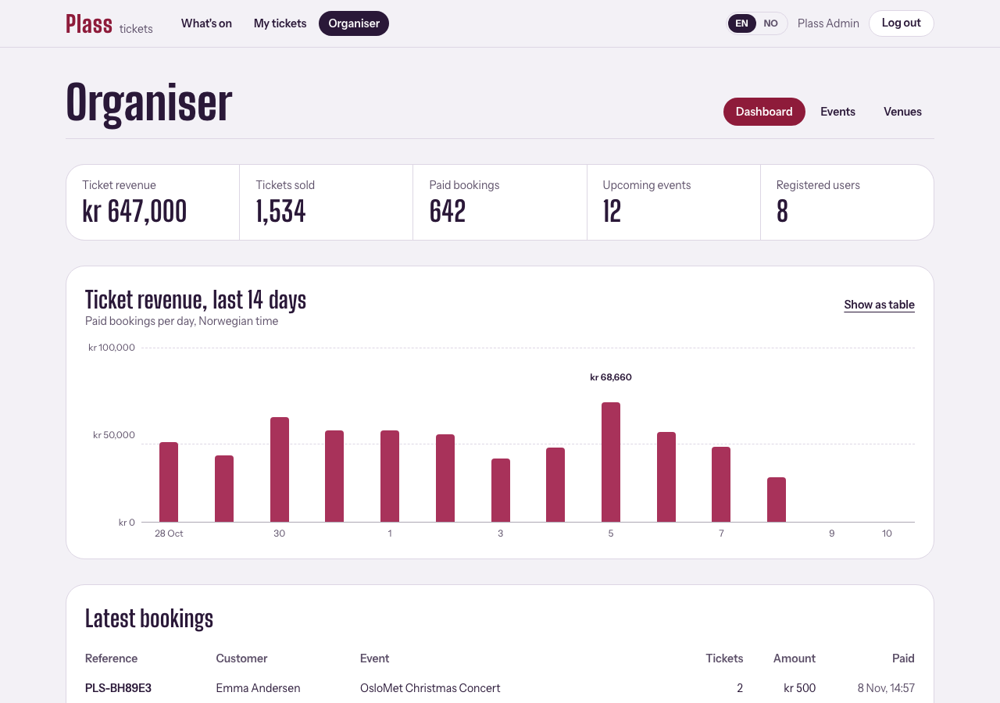
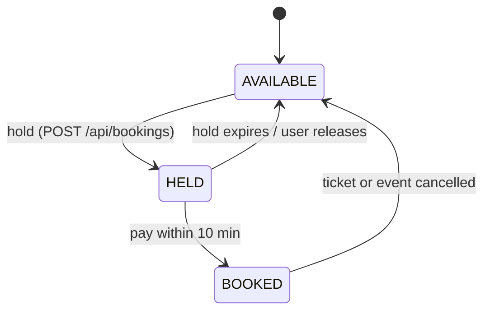

# Plass: event ticket booking

Plass (Norwegian for *seat* or *place*) is a full-stack ticketing system for theatre, concerts and comedy shows in Norway. Visitors browse what's on in Oslo, Bergen and Trondheim (including student events at OsloMet), pick seats on a live seat map, hold them for 10 minutes while they pay, and get a ticket with a QR code. Organisers create venues and events and follow sales on a dashboard.

The main engineering problem is the one every real box office has: **two people must never be able to buy the same seat**, even when they click at the same millisecond.



| Seat map | Checkout with seat hold |
| --- | --- |
|  |  |
| **My tickets** | **Organiser dashboard** |
|  |  |

## Features

**Ticket buyers**
- The whole interface is available in **English and Norwegian (Bokmål)**; the choice is remembered, and Norwegian browsers get Norwegian by default
- Prices in Norwegian kroner (NOK), times in Norwegian time (Europe/Oslo)
- Search upcoming events by text, city and category (paginated)
- Interactive seat map with three price tiers; refreshes every 10 seconds, and seats someone else takes drop out of your selection
- Two-step checkout: seats are **held for 10 minutes**, then paid (payment is simulated)
- Unpaid holds expire automatically and the seats go back on sale
- "My tickets" with QR codes; paid tickets can be cancelled (and refunded) until 24 hours before the show

**Organisers (ADMIN role)**
- Dashboard: revenue, tickets sold, a 14-day sales chart and the latest bookings
- Create venues with a seating plan (rows × seats per row)
- Create events; seats are generated from the venue plan (front rows VIP, then Premium, then Standard)
- Cancel an event, which cancels and refunds every booking for it

## How double booking is prevented



1. **Optimistic locking on every seat.** `Seat` has a `@Version` column, so Hibernate updates it with
   `UPDATE seats SET status = 'HELD', version = 1 WHERE id = ? AND version = 0`.
   When two transactions race for the same seat, only one UPDATE matches; the other fails with an
   `ObjectOptimisticLockingFailureException`, which the API returns as `409 Conflict` with the seat labels.
   `BookingService.holdSeats` flushes inside the method so the conflict surfaces there, not at commit.
2. **Consistent lock order.** `hibernate.order_updates=true` writes rows in primary-key order, so two
   overlapping selections can't deadlock each other.
3. **Hold, then pay.** A booking starts as `PENDING` with an `expiresAt`. A scheduled job
   (`BookingExpiryJob`) releases overdue holds. `Booking` also has a `@Version`, so "user pays" and
   "hold expires" can't both win.
4. **Proven by a test.** `BookingConcurrencyTest` starts 20 threads that try to hold the same seat at
   the same moment against a real PostgreSQL database (Testcontainers) and asserts that **exactly one**
   succeeds. A second test checks that different seats can still be booked in parallel.

## Tech stack

| Layer | Technology |
| --- | --- |
| Backend | Java 21, Spring Boot 4.1, Spring Web MVC, Spring Data JPA (Hibernate 7), Bean Validation |
| Security | Spring Security 7, stateless JWT (HS256) via the OAuth2 resource server, BCrypt |
| Database | PostgreSQL 17, Flyway migrations |
| API docs | springdoc-openapi (Swagger UI) |
| Tests | JUnit 5, Mockito, AssertJ, MockMvc, Testcontainers |
| Frontend | React 19, TypeScript, Vite, React Router, Tailwind CSS 4 |
| Delivery | Docker multi-stage builds, Docker Compose, nginx, GitHub Actions CI |

## Run it

You only need Docker:

```bash
docker compose up --build
```

Then open **http://localhost:3000**. The database is filled with demo data on first start.

| Account | Email | Password |
| --- | --- | --- |
| Ticket buyer | `demo@plass.dev` | `Demo1234!` |
| Organiser | `admin@plass.dev` | `Admin123!` |

Swagger UI: http://localhost:3000/swagger-ui.html (log in via `/api/auth/login`, then press **Authorize** and paste the token).

### Local development

```bash
docker compose up -d db                     # PostgreSQL only
cd backend && ./mvnw spring-boot:run        # API on http://localhost:8080
cd frontend && npm install && npm run dev   # UI on http://localhost:5173 (proxies /api to 8080)
```

Configuration is read from environment variables: `DB_URL`, `DB_USERNAME`, `DB_PASSWORD`, `JWT_SECRET`
(at least 32 bytes) and `SEED_DEMO_DATA`.

## Tests

```bash
cd backend && ./mvnw verify
```

| Test | What it checks |
| --- | --- |
| `BookingTest` | The booking state machine (hold, pay, expire, cancel) as pure unit tests |
| `BookingServiceTest` | Business rules with mocked repositories: seat limit, closed events, taken seats, lost races, expired holds |
| `SeatLayoutTest` | Seat generation and price tiers |
| `BookingConcurrencyTest` | 20 simultaneous requests for one seat: exactly one wins |
| `BookingFlowTest` | Full checkout on PostgreSQL: replace a hold, expire it, cancellation rules, privacy |
| `AuthApiTest`, `EventApiTest`, `AdminApiTest` | The HTTP API end to end: validation errors, 401 vs 403, problem-detail responses |

Integration tests use Testcontainers, so Docker must be running. Without Docker they are skipped and
only the unit tests run. CI runs everything on every push.

```bash
cd frontend && npm run lint && npm run build
```

## API overview

| Method | Path | Access | Purpose |
| --- | --- | --- | --- |
| POST | `/api/auth/register`, `/api/auth/login` | public | Get a JWT |
| GET | `/api/auth/me` | user | Current user |
| GET | `/api/events?q=&city=&category=&page=&size=` | public | Search upcoming events |
| GET | `/api/events/{id}`, `/api/events/{id}/seats` | public | Event details and seat map |
| POST | `/api/bookings` | user | Hold seats (`{eventId, seatIds}`) |
| GET | `/api/bookings`, `/api/bookings/{id}` | user | My bookings |
| POST | `/api/bookings/{id}/pay`, `/api/bookings/{id}/cancel` | user | Pay or cancel |
| GET | `/api/admin/dashboard`, `/api/admin/events` | admin | Sales figures |
| POST | `/api/admin/venues`, `/api/admin/events`, `/api/admin/events/{id}/cancel` | admin | Manage the programme |

Errors follow [RFC 9457](https://www.rfc-editor.org/rfc/rfc9457) problem details plus a stable `code`:

```json
{ "status": 409, "title": "Conflict", "code": "SEATS_UNAVAILABLE",
  "detail": "Sorry, these seats were just taken: C7", "seats": ["C7"] }
```

## Project structure

```
backend/src/main/java/com/plass
├── auth       register, login, JWT issuing
├── user       User entity and repository
├── venue      venues and seating plans
├── event      events, seats, search (Specifications), seat layout
├── booking    holds, payment, cancellation, expiry job   <- the core
├── payment    PaymentGateway port + simulated implementation
├── admin      organiser endpoints and dashboard queries
├── common     error handling, pagination DTO
├── config     security, OpenAPI, clock, password encoder
└── seed       demo data for an empty database

frontend/src
├── api        typed API client and response types
├── auth       auth context and route guards
├── i18n       English and Norwegian texts, language switch, NOK and Oslo-time formatting
├── components seat map, ticket, sales chart, layout
└── pages      events, event detail, checkout, tickets, organiser pages
```

The backend is organised **by feature** rather than by layer, so everything about bookings lives in one
package. Entities hold their own rules (`Booking.hold()`, `confirm()`, `cancel()`, `expire()`), and
services coordinate transactions.

## Design decisions

- **Flyway owns the schema**, Hibernate only validates it (`ddl-auto: validate`).
- **Open Session in View is off**, so all entity-to-DTO mapping happens inside service transactions.
- **No N+1 queries** on list pages: `@EntityGraph` fetches venues together with events, seat counts
  for a whole page come from one `GROUP BY` query, and lazy collections load in batches.
- **Prices are copied into booking items**, so old tickets keep their price if an event's prices change.
- **Time comes from an injected `Clock`**, so tests can jump forward 11 minutes to expire a hold.
- **Other users' bookings return 404, not 403**, so the API doesn't reveal that they exist.
- **Translations live in the frontend.** The API returns stable error `code`s (and, for validation errors,
  the failed constraint per field in `errorCodes`), and the React app turns them into English or Norwegian text.
  `nb` is typed against the English dictionary, so a missing translation fails the build.
- **The payment provider sits behind an interface** (`PaymentGateway`), so a real provider can replace
  the simulation without touching booking logic.

## Possible next steps

- Distributed lock for the expiry job (e.g. ShedLock) when running several instances
- Real payment provider with webhooks and idempotency keys
- Push seat updates over WebSocket or Server-Sent Events instead of polling
- Refresh tokens in an httpOnly cookie instead of a token in `localStorage`
- Rate limiting on login and booking endpoints
- E-mail tickets via an outbox table and a background worker
